# PowerWize — System Documentation

System architecture, data-flow diagrams, UML models, and the entity-relationship
diagram for the PowerWize training-and-consultation platform.

Every diagram here was derived from the running source rather than drawn from
intent: the ERD is a transcription of `init_db()` in
[../src/db/core.py](../src/db/core.py), the component diagram follows the
blueprints registered in [../src/app.py](../src/app.py), and the use-case actors
match the `CAPABILITIES` map in [../src/permissions.py](../src/permissions.py).

Diagrams are written in Mermaid and render natively on GitHub.

**Contents**

1. [System architecture](#1-system-architecture)
2. [Context diagram (DFD level 0)](#2-context-diagram-dfd-level-0)
3. [Data-flow diagram (level 1)](#3-data-flow-diagram-level-1)
4. [Use-case diagram](#4-use-case-diagram)
5. [Entity-relationship diagram](#5-entity-relationship-diagram)
6. [Sequence diagrams](#6-sequence-diagrams)
7. [Module structure](#7-module-structure)

---

## 1. System architecture

PowerWize is a server-rendered Flask application. There is no SPA framework and
no build step: templates are Jinja2, the frontend is vanilla ES5-era JavaScript
that self-initialises from `data-` attributes, and persistence is raw `psycopg2`
against PostgreSQL with no ORM and no migration framework.

Four external services are integrated, and the system is deliberately designed so
that two of them can fail without taking a transaction down with them.

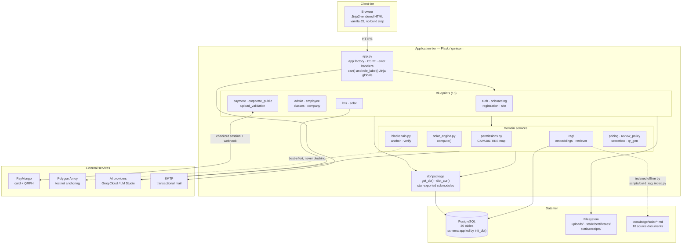

### Architectural decisions worth noting

| Decision | Rationale |
|---|---|
| **Schema lives in code** | `init_db()` is the entire schema — `CREATE TABLE IF NOT EXISTS` plus idempotent `ALTER TABLE ... ADD COLUMN IF NOT EXISTS` plus inline backfills. It re-runs on every boot, so a fresh clone and a long-lived database converge on the same shape without a migration tool. |
| **One capability map** | No route compares a role string inline. `CAPABILITIES` maps capability to roles, and `can()` is exposed as a Jinja global, so a hidden button and the route behind it read the same table and cannot disagree. |
| **Per-account capability overrides** | `user_capabilities` stores deviations from the role default, so one trainer can run training modules and another PV consultations. Enforcement goes through `current_can()`, which resolves default-then-override. |
| **Blockchain is best-effort** | Payments and certificates are valid whether or not the Polygon write lands. Failures are logged and surfaced in the UI as "Off-chain" with a re-anchor action; they never abort the transaction. |
| **Split AI providers** | `TEXT_PROVIDER`, `VISION_PROVIDER`, and `EMBED_PROVIDER` are independent knobs. A model good at reading a government ID is not the one you want writing quiz questions, and changing the chat model must not force a re-index. |
| **Numbers are never LLM-authored** | Every figure in a solar consultation comes from `solar_engine.compute()`. The model writes only number-free framing sentences, and a post-generation check discards its text if it contains a number matching no known value. |

### Technology stack

| Layer | Technology |
|---|---|
| Language / runtime | Python 3, Flask (WSGI, served by gunicorn) |
| Templating | Jinja2 — `templates/` at project root, shared macros in `templates/shared/` |
| Frontend | Vanilla JavaScript, no framework, no bundler; `IntersectionObserver`-driven motion |
| Database | PostgreSQL 18, accessed through raw `psycopg2` with `RealDictCursor` |
| Payments | PayMongo — card and QRPH, hosted checkout for corporate invoices |
| Blockchain | Polygon Amoy testnet via `web3.py` |
| AI | Groq Cloud or a local LM Studio server, selected per workload by env var |
| Retrieval | Brute-force cosine similarity over `REAL[]` embedding columns |
| Mail | SMTP |

---

## 2. Context diagram (DFD level 0)

The system boundary and the six external entities that cross it.

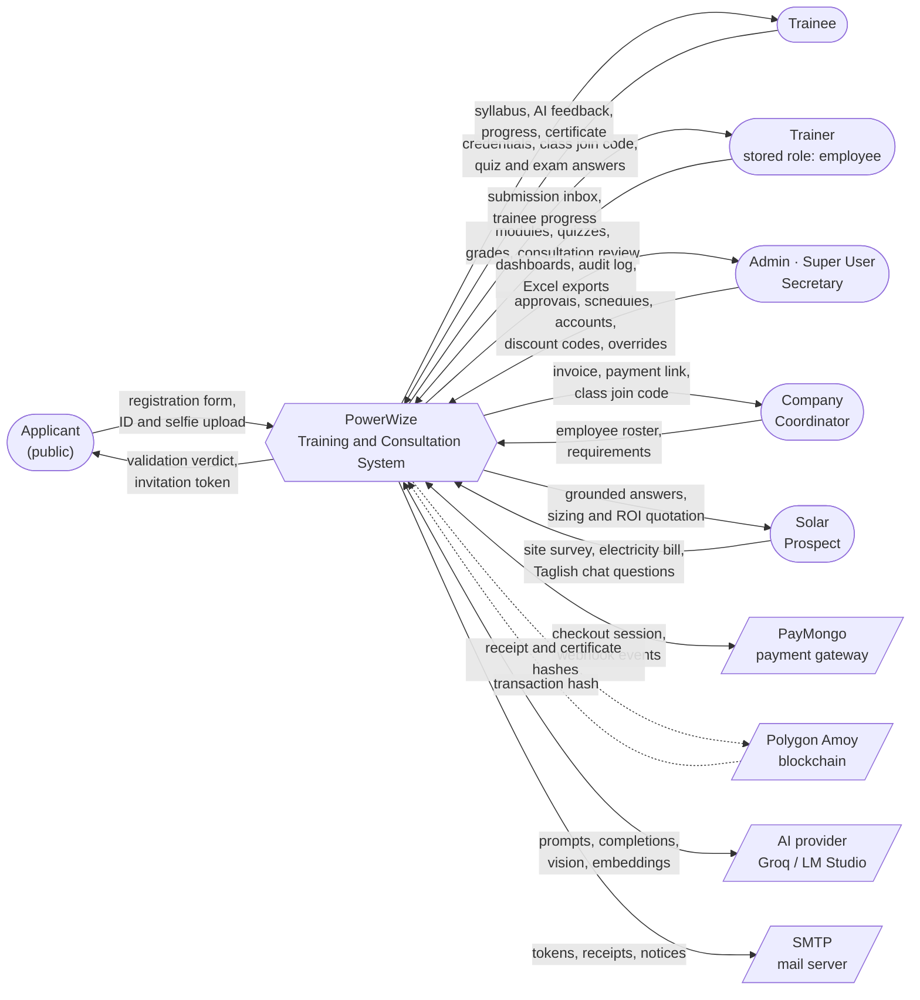

---

## 3. Data-flow diagram (level 1)

The eight major processes inside the boundary and the data stores they touch.
Store numbering is reused in the ERD section.

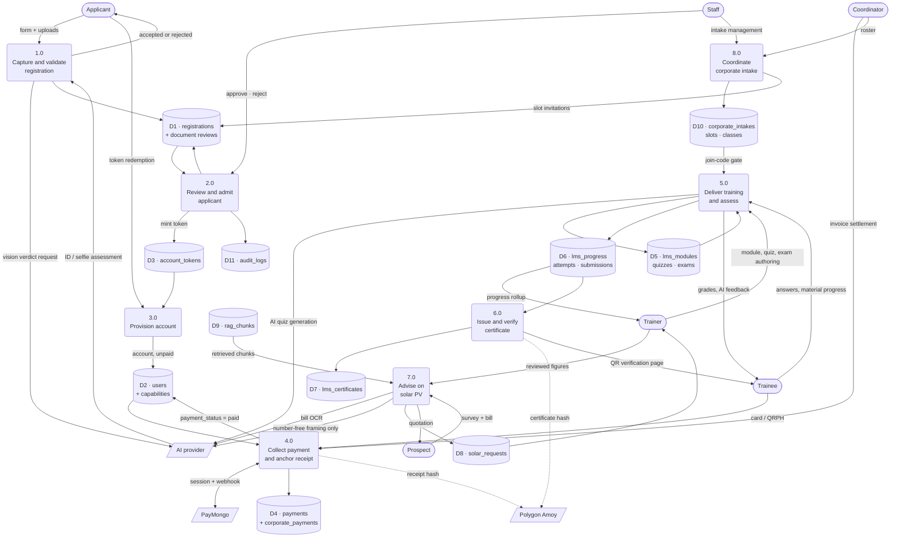

### Process summary

| # | Process | Implemented in |
|---|---|---|
| 1.0 | Capture and validate registration | [../src/registration.py](../src/registration.py), [../src/upload_validation.py](../src/upload_validation.py) |
| 2.0 | Review and admit applicant | [../src/admin/registrations.py](../src/admin/registrations.py), [../src/review_policy.py](../src/review_policy.py) |
| 3.0 | Provision account | [../src/onboarding.py](../src/onboarding.py), [../src/auth.py](../src/auth.py) |
| 4.0 | Collect payment and anchor receipt | [../src/payment_bp.py](../src/payment_bp.py), [../src/paymongo.py](../src/paymongo.py), [../src/corporate_checkout.py](../src/corporate_checkout.py) |
| 5.0 | Deliver training and assess | [../src/lms_bp/](../src/lms_bp/) |
| 6.0 | Issue and verify certificate | [../src/lms_bp/certificates.py](../src/lms_bp/certificates.py), [../src/blockchain.py](../src/blockchain.py) |
| 7.0 | Advise on solar PV | [../src/solar_bp.py](../src/solar_bp.py), [../src/solar_engine.py](../src/solar_engine.py), [../src/rag/](../src/rag/) |
| 8.0 | Coordinate corporate intake | [../src/admin/intake.py](../src/admin/intake.py), [../src/company_bp.py](../src/company_bp.py), [../src/classes_bp.py](../src/classes_bp.py) |

---

## 4. Use-case diagram

Five stored roles: `admin`, `super_user`, `secretary`, `employee`, `trainee`.
**`employee` is the stored value for what the interface calls a "Trainer"** — the
label changed, the value never did.

Super User is an Admin minus user management and minus deleting other people's
modules. Secretary is a Super User minus PV consultations. A Trainer's remit is
set per account rather than by role, so the two dashed capabilities below can be
granted or withdrawn individually.

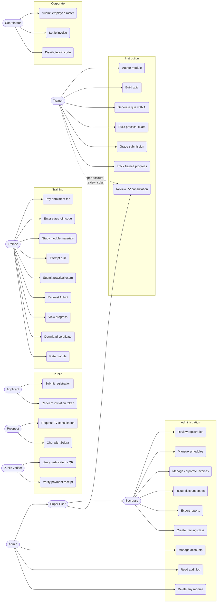

### Capability matrix

Transcribed from `CAPABILITIES` in [../src/permissions.py](../src/permissions.py).
`O` marks a capability that can be overridden per account via `user_capabilities`.

| Capability | Admin | Super User | Secretary | Trainer | Trainee |
|---|:--:|:--:|:--:|:--:|:--:|
| `view_admin_console` | ✓ | ✓ | ✓ | | |
| `view_reports` | ✓ | ✓ | ✓ | | |
| `manage_users` | ✓ | | | | |
| `review_registrations` | ✓ | ✓ | ✓ | | |
| `manage_schedules` | ✓ | ✓ | ✓ | | |
| `manage_modules` | ✓ | ✓ | ✓ | ✓ **O** | |
| `manage_any_module` | ✓ | | | | |
| `review_solar` | ✓ | ✓ | | ✓ **O** | |
| `corporate_payments` | ✓ | ✓ | ✓ | | |
| `discount_codes` | ✓ | ✓ | ✓ | | |

User management, billing, and console access are role-defining and deliberately
**not** grantable per user; only `manage_modules` and `review_solar` on Trainer
are overridable.

---

## 5. Entity-relationship diagram

36 tables. Presented as five domain views rather than one unreadable sheet; a
consolidated relationship list follows. All keys are as declared in `init_db()`.

### 5.1 Identity, registration, and admission

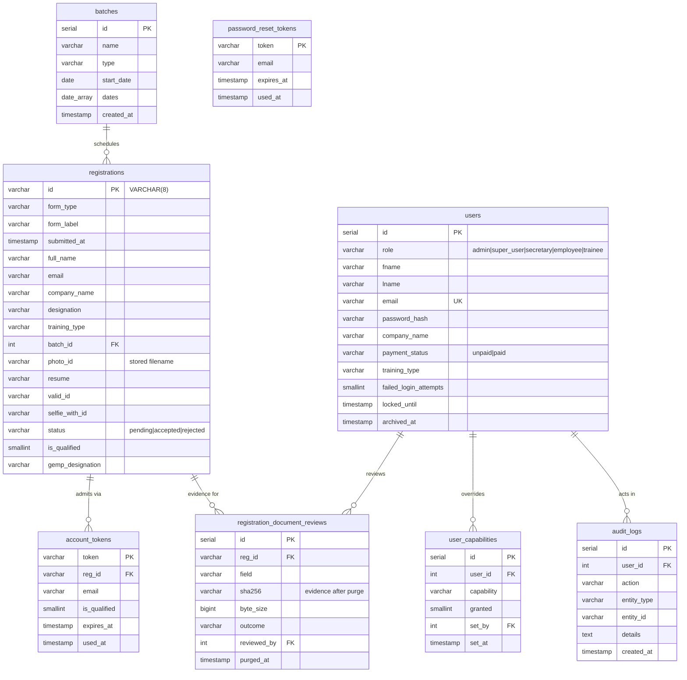

`account_tokens` is the only bridge from `registrations` to `users`: there is
deliberately **no public signup route**, so an account cannot exist without an
approved registration behind it.

### 5.2 Learning management

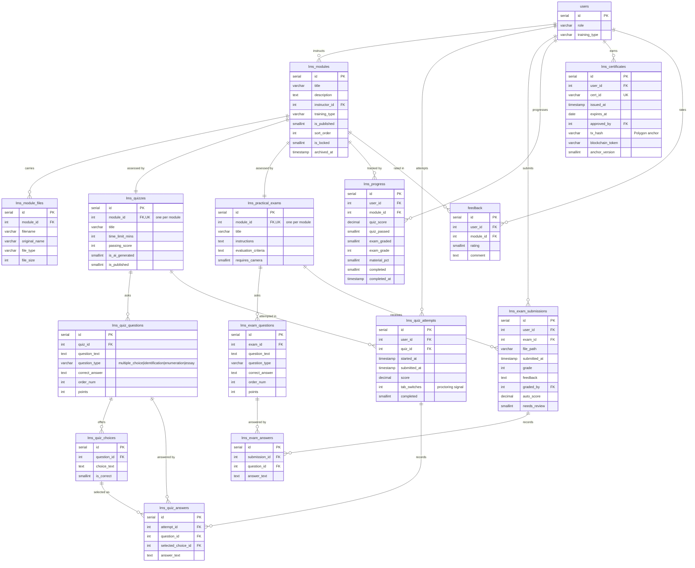

`lms_progress` and `feedback` both carry `UNIQUE (user_id, module_id)` — one
progress row and one rating per trainee per module. A trainee's syllabus is
resolved from `training_type`, never from identity.

### 5.3 Payments and billing

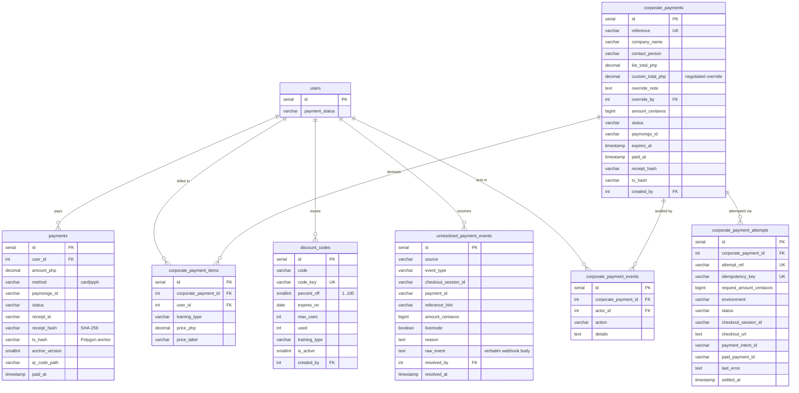

`corporate_payment_attempts` carries `UNIQUE` on both `attempt_ref` and
`idempotency_key`, which is what makes settlement idempotent at the database
level rather than in application logic. A webhook that cannot be matched to an
invoice lands in `unresolved_payment_events` with its raw body intact instead of
being dropped — nothing is silently swallowed.

### 5.4 Corporate intake and class gating

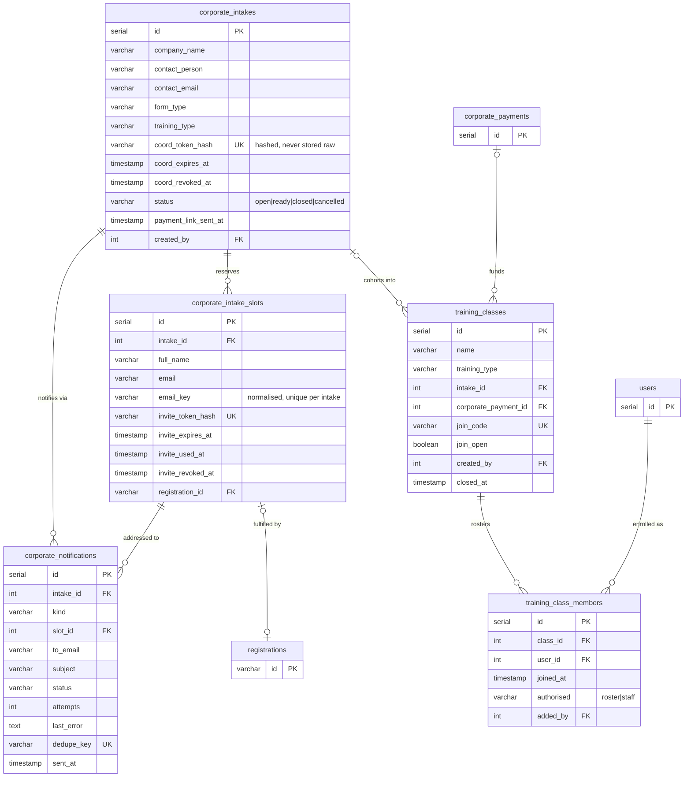

**The join code names a class; it never authorises.** `class_gate()` in
[../src/db/classes.py](../src/db/classes.py) re-derives entitlement on every
access, so a membership row is not standing authority — a later rejection,
roster revocation, or cancelled invoice closes access without anyone deleting
the row.

Two documented exceptions to "a corporate trainee must enter a code":

- **Individual enrolment is never gated.** Someone who paid for themselves is on
  no corporate invoice, so there is no class to join.
- **Access is open until a class exists** for their invoice or intake in that
  programme. If staff have not created one there is no code to enter, and
  denying training already paid for because of an internal gap is the wrong
  failure. The gate appears the moment the class does. This is a real hole in
  the rule, accepted knowingly.

### 5.5 Solar consultation and retrieval

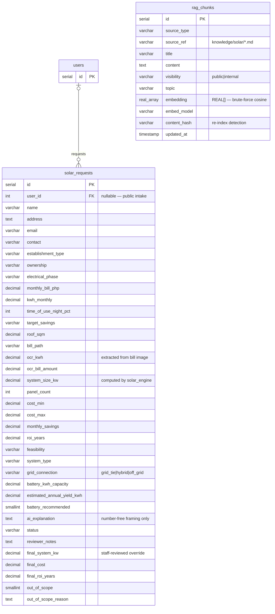

`rag_chunks` has no foreign keys by design: it is a derived index rebuilt from
`knowledge/solar/*.md` by `scripts/build_rag_index.py`, and `content_hash` is
what lets a re-index skip unchanged chunks. The paired `*_php` / `final_*`
columns on `solar_requests` keep the engine's computation and the staff-reviewed
figure separately auditable rather than overwriting one with the other.

### 5.6 Consolidated relationship list

| Parent | Child | Cardinality | On delete |
|---|---|---|---|
| `batches` | `registrations` | 1:N | SET NULL |
| `registrations` | `account_tokens` | 1:N | CASCADE |
| `registrations` | `registration_document_reviews` | 1:N | CASCADE |
| `registrations` | `corporate_intake_slots` | 1:1 | SET NULL |
| `users` | `user_capabilities` | 1:N | CASCADE |
| `users` | `payments` | 1:N | CASCADE |
| `users` | `solar_requests` | 1:N | SET NULL |
| `users` | `lms_modules` | 1:N | CASCADE |
| `users` | `lms_quiz_attempts` | 1:N | CASCADE |
| `users` | `lms_exam_submissions` | 1:N | CASCADE |
| `users` | `lms_progress` | 1:N | CASCADE |
| `users` | `lms_certificates` | 1:N | CASCADE |
| `users` | `feedback` | 1:N | CASCADE |
| `users` | `training_class_members` | 1:N | CASCADE |
| `users` | `corporate_payment_items` | 1:N | CASCADE |
| `users` | `audit_logs` | 1:N | SET NULL |
| `lms_modules` | `lms_module_files` | 1:N | CASCADE |
| `lms_modules` | `lms_quizzes` | 1:1 | CASCADE |
| `lms_modules` | `lms_practical_exams` | 1:1 | CASCADE |
| `lms_modules` | `lms_progress` | 1:N | CASCADE |
| `lms_modules` | `feedback` | 1:N | CASCADE |
| `lms_quizzes` | `lms_quiz_questions` | 1:N | CASCADE |
| `lms_quizzes` | `lms_quiz_attempts` | 1:N | CASCADE |
| `lms_quiz_questions` | `lms_quiz_choices` | 1:N | CASCADE |
| `lms_quiz_questions` | `lms_quiz_answers` | 1:N | CASCADE |
| `lms_quiz_choices` | `lms_quiz_answers` | 1:N | SET NULL |
| `lms_quiz_attempts` | `lms_quiz_answers` | 1:N | CASCADE |
| `lms_practical_exams` | `lms_exam_questions` | 1:N | CASCADE |
| `lms_practical_exams` | `lms_exam_submissions` | 1:N | CASCADE |
| `lms_exam_submissions` | `lms_exam_answers` | 1:N | CASCADE |
| `lms_exam_questions` | `lms_exam_answers` | 1:N | CASCADE |
| `corporate_intakes` | `corporate_intake_slots` | 1:N | CASCADE |
| `corporate_intakes` | `corporate_notifications` | 1:N | CASCADE |
| `corporate_intakes` | `training_classes` | 1:N | SET NULL |
| `corporate_intake_slots` | `corporate_notifications` | 1:N | SET NULL |
| `corporate_payments` | `corporate_payment_items` | 1:N | CASCADE |
| `corporate_payments` | `corporate_payment_attempts` | 1:N | CASCADE |
| `corporate_payments` | `corporate_payment_events` | 1:N | CASCADE |
| `corporate_payments` | `training_classes` | 1:N | SET NULL |
| `training_classes` | `training_class_members` | 1:N | CASCADE |
| `discount_codes` | — | standalone | — |
| `rag_chunks` | — | derived index | — |
| `password_reset_tokens` | — | keyed by email | — |
| `unresolved_payment_events` | — | webhook quarantine | — |

---

## 6. Sequence diagrams

### 6.1 The trainee lifecycle

This one flow spans most of the codebase, which is why several otherwise-odd
design choices exist.

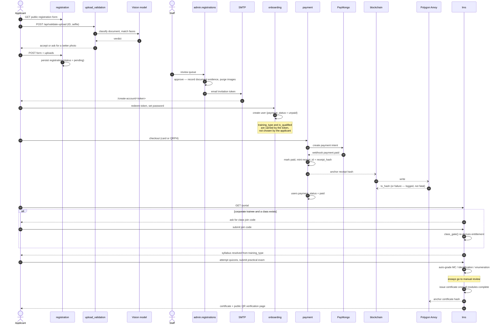

### 6.2 A Solara consultation turn

The gate runs **before** any chat LLM call, and the model never authors a number.

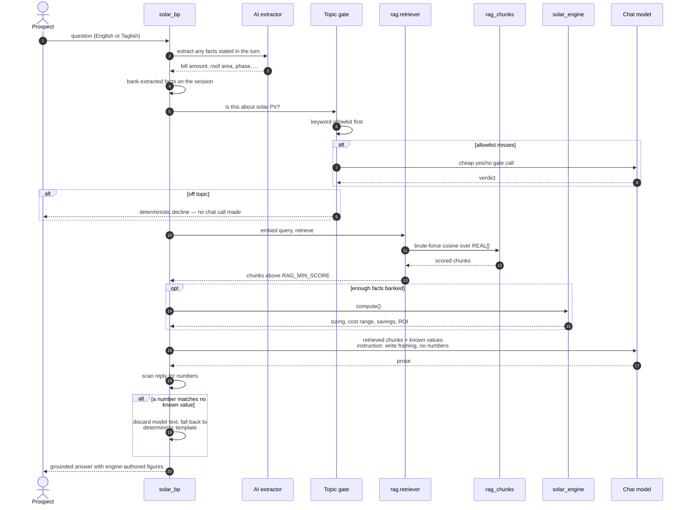

### 6.3 Corporate invoice settlement

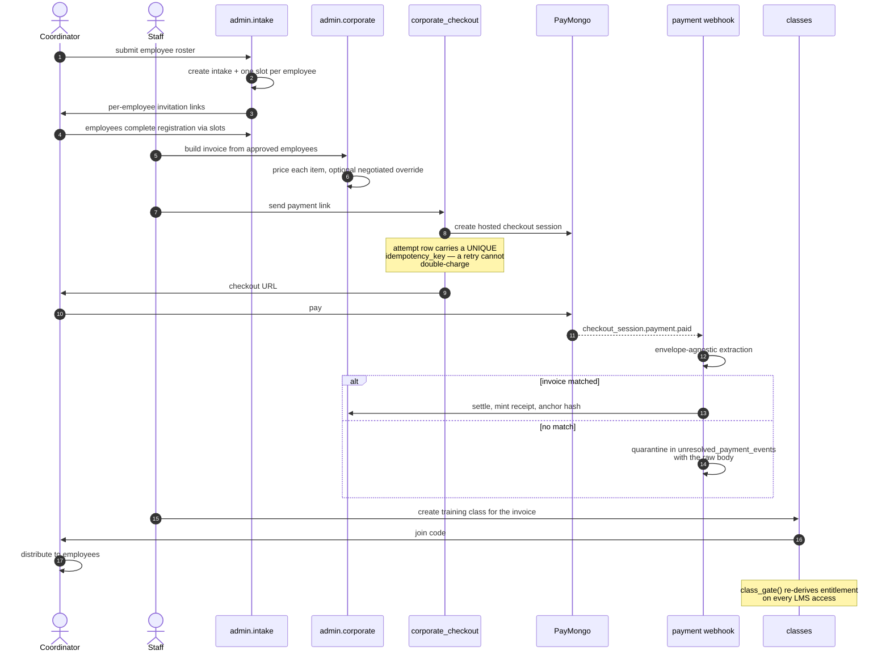

---

## 7. Module structure

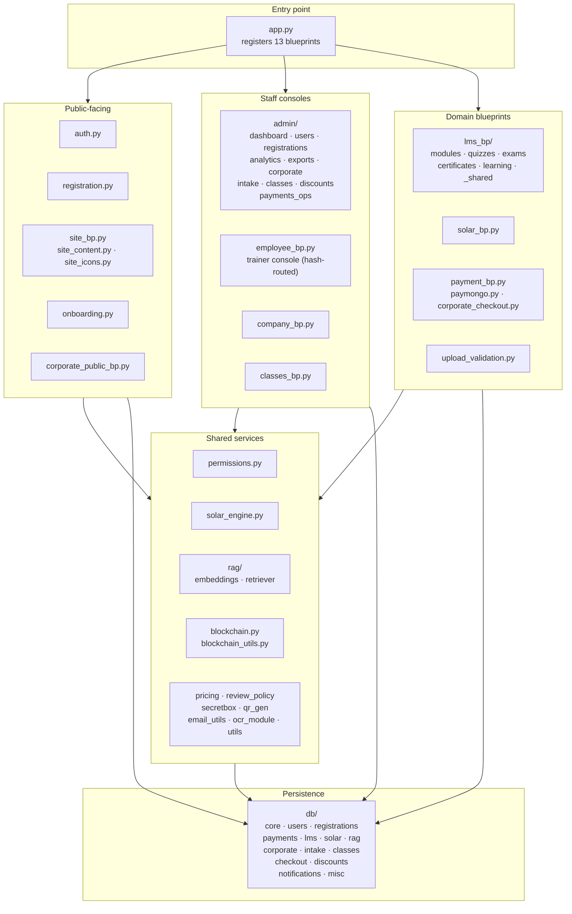

### Package conventions

- **Flat sibling imports.** Every module imports its siblings flat
  (`from db import ...`, `from lms_bp._shared import ...`), so the app must run
  with `src/` as the working directory and on `sys.path`. `Procfile` does this
  with `gunicorn --chdir src app:app`.
- **`db/` star-exports its submodules** from `__init__.py`, so callers always
  write `from db import <anything>` regardless of which file a function lives in.
  `get_db()` returns a connection and `dict_cur(conn)` a `RealDictCursor`;
  callers close both by hand.
- **`lms_bp/` and `admin/` create their blueprint in `__init__.py`, then import
  their route modules at the bottom.** The circular-looking import is
  deliberate — it is what lets each route module write `from . import lms_bp`.
- **Progress folds through one function.** Trainer-facing and trainee-facing
  progress both go through `_progress_steps()` in
  [../src/lms_bp/_shared.py](../src/lms_bp/_shared.py), so the two views cannot
  disagree.

### Security notes

| Control | Where |
|---|---|
| CSRF | Global via `CSRFProtect`. Three views are genuinely exempt (PayMongo webhook and the two upload-validation APIs). `solar_chat_cancel` is exempt only from the automatic header check — `navigator.sendBeacon()` cannot set one — and validates the token out of the JSON body itself. |
| Password storage | Werkzeug password hashing; `failed_login_attempts` and `locked_until` throttle credential stuffing. |
| Account creation | Invitation-only. A plain email+password signup would mint trainees that skipped ID upload, selfie liveness, and admin verification. |
| Token handling | Coordinator and slot invitation tokens are stored as SHA-256 hashes (`coord_token_hash`, `invite_token_hash`), never in the clear, and carry explicit expiry and revocation columns. |
| Document minimisation | Government IDs and selfies are purged after review; `registration_document_reviews` retains only a SHA-256 digest, byte size, extension, and the outcome as audit evidence. |
| Authorisation | Single `CAPABILITIES` table; `current_can()` resolves per-account overrides. Wrong role raises `abort(403)`, and the handler content-negotiates HTML against JSON. |
| Payment integrity | `UNIQUE` idempotency keys at the database level; unmatched webhooks are quarantined with their raw body rather than dropped. |
